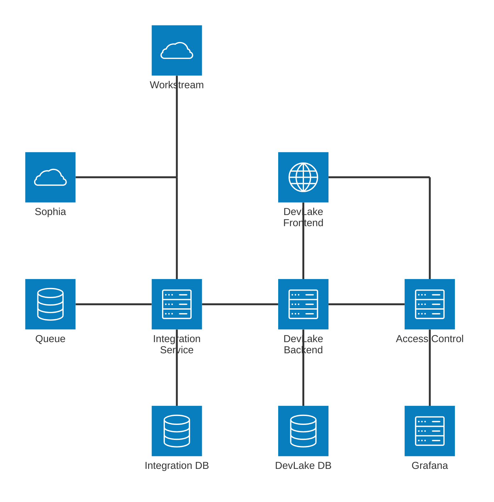
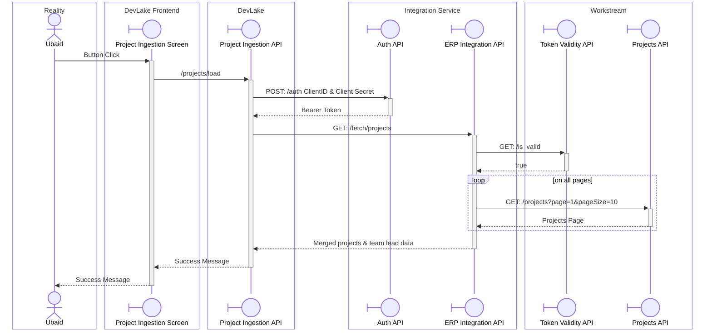
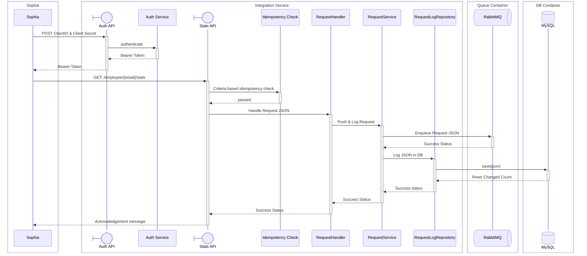
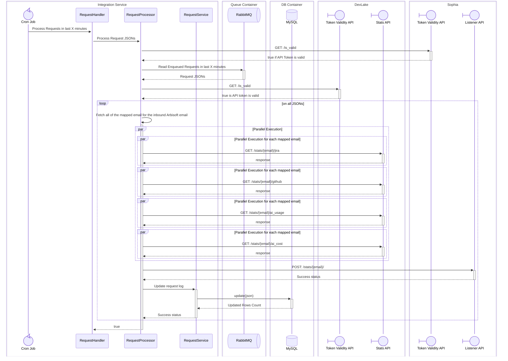
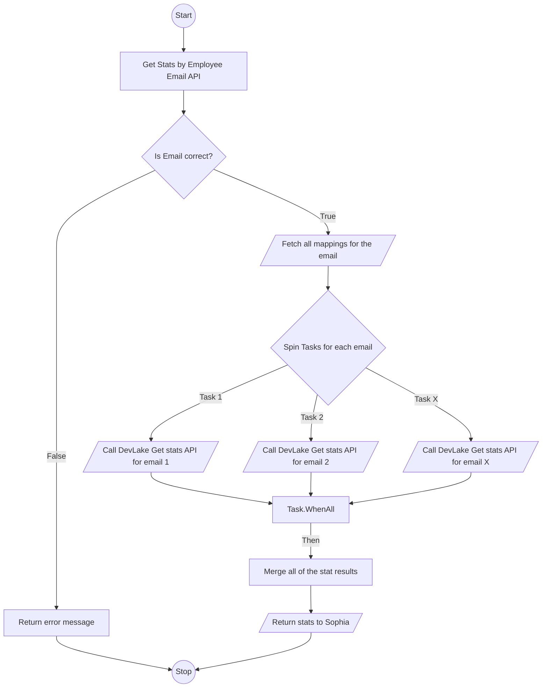

# Integration Service
This integration service is to connect DevLake with 3rd party systems. All of the systems who want to take data from DevLake must interact only with Integration Service, not directly with DevLake.

## Technology Stack
- Backend: .NET 10, I have selected this stack because I have better knowledge of managing multi-threaded operations.
- Database: MySQL.
- Queuing System: RabbitMQ.

## Communication
I have selected Asynchronous mode of communication for this service, such that if there are too many requests coming in from the client system then the service would simply push the request to queuing system, and would process it on its own processing time.

Secondly, the data required from Sophia against single engineer can cause frequent API timeouts, hence async communication is the best option.

## Authentication
I have selected OAuth2 Authentication Mode, the client will be first registered on the integration service. A Client ID and Secret will be created for the client, client will pass these 2 values to our systems auth API, and will receive a Bearer token to access the APIs.

## Architecture Diagram
As per my understanding, current DevLake system is the right hand side of the diagram. I have added the left side of the diagram for integration with Sophia and other systems.



## Domain Diagram

```mermaid
erDiagram

    EmailMappings {
        bigint id PK
        string arbisoftEmail
        string email
        DateTime createdOn
    }

    Clients {
        bigint id PK
        string clientId UK
        string name
        bool isActive
        int accessTokenLifetimeSeconds
        DateTime createdOn
        string createdBy
        DateTime? modifiedOn
        string? modifiedBy 
    }

    ClientSecrets {
        bigint id PK
        bigint clientRefId FK
        string secret
        DateTime expiresOn 
        DateTime revokedOn 
        DateTime lastUsedOn 
        DateTime createdOn
        string createdBy
    }

    ClientScopes {
        bigint id PK
        bigint clientRefId FK 
        bigint scopeId FK
        DateTime createdOn
        string createdBy
    }

    Scopes {
        bigint id PK
        string name UK
        string description
        DateTime createdOn
    }

    SigningKeys {
        bigint id PK
        string kid UK
        string algorithm
        string publicKey
        string privateKeyRef
        DateTime activatedOn
        DateTime? retiredOn
        DateTime createdOn
    }

    AccessTokens {
        bigint id PK
        string jti UK
        bigint clientRefId FK
        bigint clientSecretId FK
        bigint signingKeyId FK
        string grantedScopes
        DateTime issuedOn
        DateTime expiresOn
        DateTime? revokedOn
        string? revokedReason
        string issuedToIp
    }

    Clients ||--o{ ClientSecrets : clientRefId
    Clients ||--o{ ClientScopes : clientRefId
    Scopes ||--o{ ClientScopes : scopeId
    Clients ||--o{ AccessTokens : clientRefId
    ClientSecrets ||--o{ AccessTokens : clientSecretId
    SigningKeys ||--o{ AccessTokens : signingKeyId

    RequestLogs {
        bigint id PK
        bigint clientRefId FK
        string correlationId
        string url
        string status
        string eventType
        DateTime createdOn
    }

    RequestLogJsons {
        bigint id PK
        bigint requestLogId FK
        string json
    }

    RequestResponseAttempts {
        bigint id PK
        bigint requestLogId FK
        string responseJson
        string attemptStatus
        string? failureError
        string attemptBy
        DateTime attemptOn
    }

    ClientConfigs {
        bigint id PK
        bigint clientRefId FK, UK 
        string authType
        string baseUrl
        string? tokenUrl
        string? outboundClientId
        string? outboundClientSecretEncrypted 
        string? outboundScope
        string? apiTokenEncrypted
        DateTime? tokenExpiresOn
        DateTime? tokenRotatedOn
        int maxAttempts
        bool isActive
        DateTime createdOn
        string createdBy
        DateTime? modifiedOn
        string? modifiedBy
    }

    ClientConfigOutboundUrls {
        bigint id PK
        bigint clientConfigId FK
        string eventType
        string path 
        string method 
        bool isActive
        DateTime createdOn
        string createdBy
        DateTime? modifiedOn 
        string? modifiedBy 
    }

    Clients ||--o| ClientConfigs : clientRefId
    ClientConfigs ||--o{ ClientConfigOutboundUrls : clientConfigId
    Clients ||--o{ RequestLogs: clientRefId
    RequestLogs ||--o{ RequestLogJsons : requestLogId
    RequestLogs ||--o{ RequestResponseAttempts : requestLogId

```
- EmailMappings: Maps each engineer's Arbisoft email to the other emails they use to commit on GitHub.
- Clients: Third-party systems registered with the Integration Service. Each client has a public Client ID that it sends to the Auth API, an active flag, and the lifetime of the access tokens issued to it.
- ClientSecrets: The secrets a client sends with its Client ID to get an access token. A client can have more than one secret, so a new one can be issued before the old one is revoked. Each secret records when it expires, when it was revoked and when it was last used.
- ClientScopes: Links each client to the scopes it is allowed to request.
- Scopes: The permissions a token can carry, such as `stats:read` or `projects:fetch`. Each API checks that the token has the scope it requires.
- SigningKeys: The keys used to sign access tokens. The `kid` goes in the token header, so tokens signed before a key rotation can still be verified with the right key. The private key stays in the secret store and this table holds only a reference to it.
- AccessTokens: Every bearer token the Auth API issues, with the client, the secret it was issued against, the signing key, the granted scopes, the issue and expiry times, and the caller's IP. Setting `revokedOn` invalidates a token before it expires.
- RequestLogs: Requests received from clients and the status of each one: Received, Queued, Processed, Success or Failed.
- RequestLogJsons: The JSON body of each request log.
- RequestResponseAttempts: Each attempt to deliver a response to the client's outbound URL, with the response JSON, the attempt status and the error when an attempt fails.
- ClientConfigs: How the Integration Service authenticates when it sends data to a client. `authType` is either OAuth2 client credentials (token URL, outbound Client ID, encrypted secret and scope) or a static API token, which is what Sophia uses. Token expiry and rotation dates are tracked so a token can be replaced before it expires, and `maxAttempts` caps delivery retries.
- ClientConfigOutboundUrls: The endpoints the Integration Service sends data to for each client. Each row maps an event type to an HTTP method and a path relative to the config's base URL.

## Sequence Diagram
### 1. Loading Projects on DevLake


### 2. Sophia asking for data

#### Pushing Requests in Queue

- DevLake does not support OAuth2, it works on manually generated API token which is sent in request header `Authentication: Bearer <API Token>`

#### Processing Requests

- Sophia does not support OAuth2, it works on manually generated API Token which is sent in request header `Authentication: Bearer <API Token>`
- Sophia manually revolves the API Token after 2 months 

### 3. Sophia DevLake Flowchart


## Project Structure

```
Arbisoft.DevLake.IntegrationService
├──Arbisoft.DevLake.IntegrationService.Core
│  ├──Models
│  │  ├──EmailMapping.cs
│  │  ├──Client.cs
│  │  ├──ClientSecret.cs
│  │  ├──ClientScope.cs
│  │  ├──Scope.cs
│  │  ├──SigningKey.cs
│  │  ├──AccessToken.cs
│  │  ├──RequestLog.cs
│  │  ├──RequestLogJson.cs
│  │  ├──RequestResponseAttempt.cs
│  │  ├──ClientConfig.cs
│  │  └──ClientConfigOutboundUrl.cs
│  └──Interfaces
│     ├──Repositories
│     │  ├──IEmailMappingRepository.cs
│     │  ├──IClientRepository.cs
│     │  ├──IScopeRepository.cs
│     │  ├──ISigningKeyRepository.cs
│     │  ├──IAccessTokenRepository.cs
│     │  ├──IRequestLogRepository.cs
│     │  └──IClientConfigRepository.cs
│     ├──ExternalApis
│     │  ├──IDevLakeClient.cs
│     │  ├──ISophiaClient.cs
│     │  └──IWorkstreamClient.cs
│     ├──Messaging
│     │  ├──IRequestQueuePublisher.cs
│     │  └──IRequestQueueConsumer.cs
│     └──Security
│        ├──ISecretEncryptor.cs
│        └──ITokenGenerator.cs
├──Arbisoft.DevLake.IntegrationService.Infrastructure
│  ├──Persistence
│  │  ├──IntegrationDbContext.cs
│  │  ├──Migrations
│  │  └──Configurations
│  │     ├──EmailMappingConfiguration.cs
│  │     ├──ClientConfiguration.cs
│  │     ├──ClientSecretConfiguration.cs
│  │     ├──ClientScopeConfiguration.cs
│  │     ├──ScopeConfiguration.cs
│  │     ├──SigningKeyConfiguration.cs
│  │     ├──AccessTokenConfiguration.cs
│  │     ├──RequestLogConfiguration.cs
│  │     ├──RequestLogJsonConfiguration.cs
│  │     ├──RequestResponseAttemptConfiguration.cs
│  │     ├──ClientConfigConfiguration.cs
│  │     └──ClientConfigOutboundUrlConfiguration.cs
│  ├──Repositories
│  │  ├──EmailMappingRepository.cs
│  │  ├──ClientRepository.cs
│  │  ├──ScopeRepository.cs
│  │  ├──SigningKeyRepository.cs
│  │  ├──AccessTokenRepository.cs
│  │  ├──RequestLogRepository.cs
│  │  └──ClientConfigRepository.cs
│  ├──ExternalApis
│  │  ├──DevLake
│  │  │  └──DevLakeClient.cs
│  │  ├──Sophia
│  │  │  └──SophiaClient.cs
│  │  └──Workstream
│  │     └──WorkstreamClient.cs
│  ├──Messaging
│  │  ├──RabbitMqConnection.cs
│  │  ├──RequestQueuePublisher.cs
│  │  └──RequestQueueConsumer.cs
│  ├──Security
│  │  ├──SecretEncryptor.cs
│  │  ├──JwtTokenGenerator.cs
│  │  └──SigningKeyProvider.cs
│  └──DependencyInjection.cs
├──Arbisoft.DevLake.IntegrationService.Application
│  ├──Dtos
│  │  ├──Auth
│  │  │  ├──TokenRequest.cs
│  │  │  └──TokenResponse.cs
│  │  ├──Projects
│  │  │  └──ProjectDto.cs
│  │  ├──Stats
│  │  │  ├──StatsRequest.cs
│  │  │  ├──StatsAcknowledgement.cs
│  │  │  └──EmployeeStatsDto.cs
│  │  └──Admin
│  │     ├──ClientDto.cs
│  │     ├──ClientSecretDto.cs
│  │     ├──ScopeDto.cs
│  │     ├──SigningKeyDto.cs
│  │     ├──AccessTokenDto.cs
│  │     ├──EmailMappingDto.cs
│  │     ├──ClientConfigDto.cs
│  │     ├──ClientConfigOutboundUrlDto.cs
│  │     └──RequestLogDto.cs
│  ├──Services
│  │  ├──Auth
│  │  │  └──AuthService.cs
│  │  ├──Projects
│  │  │  └──ErpIntegrationService.cs
│  │  ├──Requests
│  │  │  ├──IdempotencyCheck.cs
│  │  │  ├──RequestHandler.cs
│  │  │  ├──RequestService.cs
│  │  │  └──RequestProcessor.cs
│  │  └──Admin
│  │     ├──ClientService.cs
│  │     ├──ScopeService.cs
│  │     ├──SigningKeyService.cs
│  │     ├──AccessTokenService.cs
│  │     ├──EmailMappingService.cs
│  │     ├──ClientConfigService.cs
│  │     └──RequestLogService.cs
│  └──DependencyInjection.cs
├──Arbisoft.DevLake.IntegrationService.API
│  ├──Controllers
│  │  ├──AuthController.cs
│  │  ├──ErpIntegrationController.cs
│  │  └──StatsController.cs
│  ├──Authorization
│  │  ├──ScopeRequirement.cs
│  │  ├──ScopeAuthorizationHandler.cs
│  │  └──TokenRevocationValidator.cs
│  ├──BackgroundJobs
│  │  └──RequestProcessingJob.cs
│  ├──Program.cs
│  └──appsettings.json
├──Arbisoft.DevLake.IntegrationService.Web
│  ├──Pages
│  │  ├──Clients
│  │  │  ├──Index.cshtml
│  │  │  ├──Create.cshtml
│  │  │  ├──Edit.cshtml
│  │  │  ├──Details.cshtml
│  │  │  └──Secrets
│  │  │     ├──Create.cshtml
│  │  │     └──Revoke.cshtml
│  │  ├──Scopes
│  │  │  ├──Index.cshtml
│  │  │  ├──Create.cshtml
│  │  │  └──Edit.cshtml
│  │  ├──SigningKeys
│  │  │  ├──Index.cshtml
│  │  │  └──Rotate.cshtml
│  │  ├──AccessTokens
│  │  │  ├──Index.cshtml
│  │  │  └──Revoke.cshtml
│  │  ├──EmailMappings
│  │  │  ├──Index.cshtml
│  │  │  ├──Create.cshtml
│  │  │  └──Edit.cshtml
│  │  ├──ClientConfigs
│  │  │  ├──Edit.cshtml
│  │  │  └──OutboundUrls
│  │  │     ├──Index.cshtml
│  │  │     ├──Create.cshtml
│  │  │     └──Edit.cshtml
│  │  └──RequestLogs
│  │     ├──Index.cshtml
│  │     └──Details.cshtml
│  ├──Program.cs
│  └──appsettings.json
└──Arbisoft.DevLake.IntegrationService.UnitTests
   ├──Application
   │  ├──Auth
   │  │  └──AuthServiceTests.cs
   │  ├──Projects
   │  │  └──ErpIntegrationServiceTests.cs
   │  ├──Requests
   │  │  ├──IdempotencyCheckTests.cs
   │  │  ├──RequestHandlerTests.cs
   │  │  ├──RequestServiceTests.cs
   │  │  └──RequestProcessorTests.cs
   │  └──Admin
   │     ├──ClientServiceTests.cs
   │     ├──ScopeServiceTests.cs
   │     ├──SigningKeyServiceTests.cs
   │     ├──AccessTokenServiceTests.cs
   │     ├──EmailMappingServiceTests.cs
   │     ├──ClientConfigServiceTests.cs
   │     └──RequestLogServiceTests.cs
   ├──Infrastructure
   │  ├──ExternalApis
   │  │  ├──DevLakeClientTests.cs
   │  │  ├──SophiaClientTests.cs
   │  │  └──WorkstreamClientTests.cs
   │  ├──Messaging
   │  │  ├──RequestQueuePublisherTests.cs
   │  │  └──RequestQueueConsumerTests.cs
   │  └──Security
   │     ├──SecretEncryptorTests.cs
   │     ├──JwtTokenGeneratorTests.cs
   │     └──SigningKeyProviderTests.cs
   ├──API
   │  ├──Controllers
   │  │  ├──AuthControllerTests.cs
   │  │  ├──ErpIntegrationControllerTests.cs
   │  │  └──StatsControllerTests.cs
   │  ├──Authorization
   │  │  ├──ScopeAuthorizationHandlerTests.cs
   │  │  └──TokenRevocationValidatorTests.cs
   │  └──BackgroundJobs
   │     └──RequestProcessingJobTests.cs
   └──TestHelpers
      ├──Builders
      │  ├──ClientBuilder.cs
      │  ├──AccessTokenBuilder.cs
      │  ├──RequestLogBuilder.cs
      │  └──ClientConfigBuilder.cs
      └──FakeHttpMessageHandler.cs
```