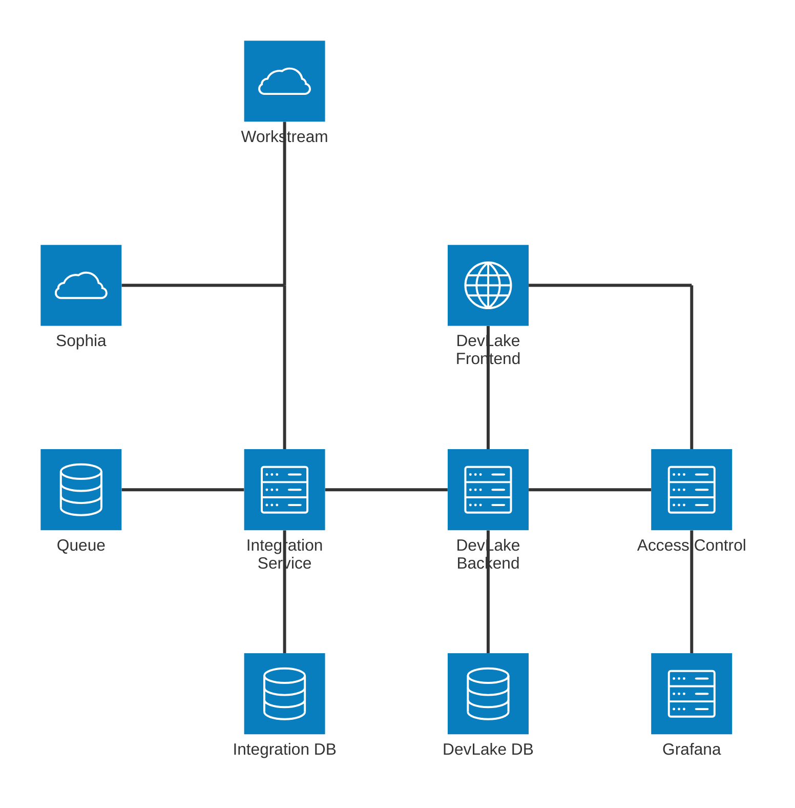
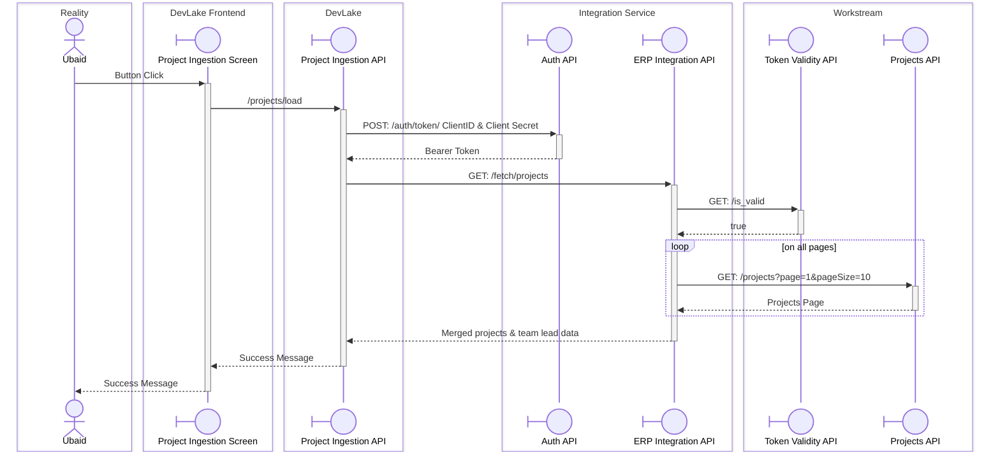
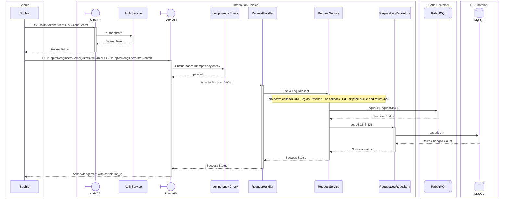
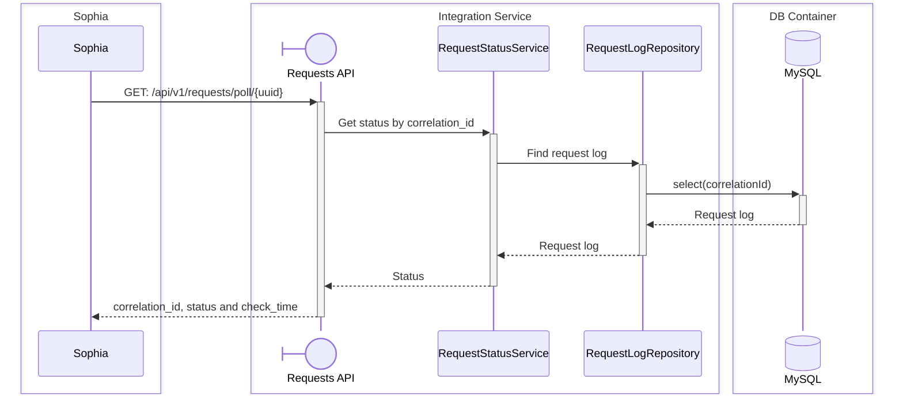
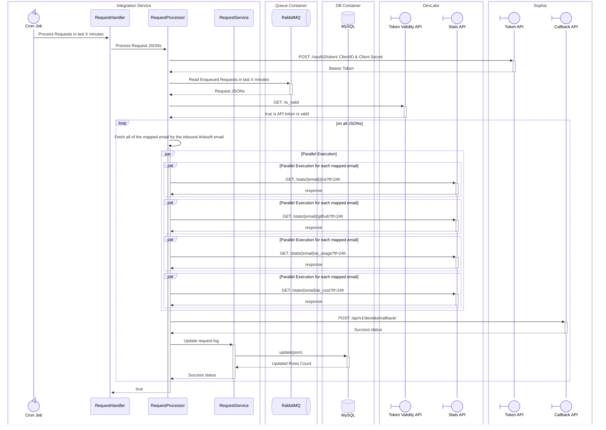
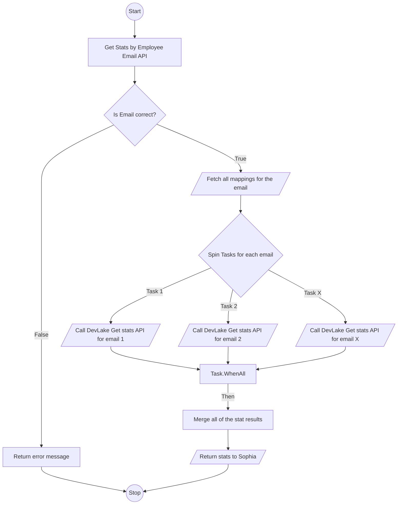

# Integration Service
The Integration Service connects DevLake with third-party systems. Any system that needs DevLake data goes through the Integration Service and never calls DevLake directly.

It handles two integrations for now. Sophia asks for an engineer's stats by their Arbisoft email. The service looks up the other emails that engineer commits with, collects their Jira, GitHub, AI usage and AI cost stats from DevLake, and posts the merged result to Sophia's callback API. DevLake also uses the service to load projects and team lead data from Workstream.

Clients authenticate with a Client ID and Secret to get a bearer token. Stats requests are queued in RabbitMQ and processed in the background, so a slow DevLake response doesn't time out the client's call.

## Technology Stack
- Backend: .NET 10, I have selected this stack because I have better knowledge of managing multi-threaded operations
- Database: MySQL
- ORM: Dapper
- Database Migrations: DbUp
- Queuing System: RabbitMQ

## Communication
I have selected Asynchronous mode of communication for this service, such that if there are too many requests coming in from the client system then the service would simply push the request to queuing system, and would process it on its own processing time.

Secondly, the data required from Sophia against single engineer can cause frequent API timeouts, hence async communication is the best option.

The stats APIs are asynchronous: they return a `correlation_id` straight away, and the result is delivered to the client's callback API later. The poll API is synchronous and returns the current status of a request.

## Authentication
- Authentication protocol: OIDC
- Authorization protocol: OAuth2

The client will be first registered on the integration service. A Client ID and Secret will be created for the client and shared using Passbolt. The client will pass these 2 values to our systems auth API, and will receive a Bearer token to access the APIs.

## API Contracts
These are the APIs agreed with Sophia. Every API except the Auth API needs the header `Authorization: Bearer <Token>`.

| API | Method and path | Mode | Rate limit | Other limits |
|---|---|---|---|---|
| Authentication | `POST [BASE_URL]/auth/token/` | Synchronous | None agreed | |
| Get Stats by Email | `GET [BASE_URL]/api/v1/engineers/{email}/stats?tf=24h` | Asynchronous | 100 requests per minute | |
| Get Stats by Email List | `POST [BASE_URL]/api/v1/engineers/stats/batch` | Asynchronous | 20 requests per minute | 20 emails per request |
| Fetch Request Status | `GET [BASE_URL]/api/v1/requests/poll/{uuid}` | Synchronous | 100 requests per minute | |

All APIs return a 2xx, 4xx or 5xx status code. Rate limits apply per client, and a client over a limit gets a 429 response.

### Authentication
Request headers:
- `Content-Type: application/x-www-form-urlencoded`
- `Authorization: Basic base64(client_id:client_secret)`

Request body:
```
grant_type=client_credentials
```

Response body:
```json
{ "access_token": "abc123blablabla...", "token_type": "Bearer", "expires_in": 3600, "scope": "items.read" }
```

### Get Stats by Email
- `email`: the engineer's Arbisoft email, for example `abc@arbisoft.com`.
- `tf`: the time frame, for example `24h`, `1w`, `30d`, `11M` or `1y`. The units are `h` (hours), `d` (days), `w` (weeks), `M` (months) and `y` (years), and they are case-sensitive. The batch API's `timeFrame` uses the same format.
- Result delivery: `[SOPHIA_BASE_URL]/api/v1/devlake/callback/`

Response body:
```json
{ "status": "200", "email": "abc@arbisoft.com", "correlation_id": "<uuid>", "error": "" }
```

### Get Stats by Email List
Result delivery: not available yet. Sophia still has to provide a callback API for this endpoint. Until then, batch requests are rejected with a 422 response and the error `Revoked - no callback URL`.

Request body:
```json
{ "emails": ["abc@arbisoft.com", "def@arbisoft.com"], "timeFrame": "24h" }
```

Response body:
```json
{ "status": "200", "emails": ["abc@arbisoft.com", "def@arbisoft.com"], "correlation_id": "<uuid>", "error": "" }
```

### Request Rejected for No Callback
Both stats APIs return HTTP 422 when no callback API is available for the request. The `correlation_id` can still be used with the poll API, which returns the status `Revoked`.

Response body for Get Stats by Email (the batch API returns `emails` instead of `email`):
```json
{ "status": "422", "email": "abc@arbisoft.com", "correlation_id": "<uuid>", "error": "Revoked - no callback URL" }
```

### Fetch Request Status
- `uuid`: the `correlation_id` received in the response of the original request.
- `status`: the current status of the request: `Queued`, `Processing`, `Success`, `Failure` or `Revoked`. These values are case-sensitive and map to the `RequestLogs` statuses as follows:

| `RequestLogs` status | Poll status |
|---|---|
| Received, Queued | `Queued` |
| Processing, Processed | `Processing` |
| Success | `Success` |
| Failed | `Failure` |
| Revoked - no callback URL | `Revoked` |

Response body:
```json
{ "correlation_id": "<uuid>", "status": "Processing", "check_time": "2026-11-05T14:02:55Z" }
```

### Sophia APIs
- Token API: `POST [SOPHIA_BASE_URL]/oauth2/token/`
- Callback API for Get Stats by Email: `POST [SOPHIA_BASE_URL]/api/v1/devlake/callback/`

### What we need from Sophia
- Client ID and Secret for the Stage environment
- Client ID and Secret for the Prod environment
- A callback API to receive the data processed for requests on `[BASE_URL]/api/v1/engineers/stats/batch`

## Architecture Diagram
As per my understanding, current DevLake system is the right hand side of the diagram. I have added the left side of the diagram for integration with Sophia and other systems.



## Domain Diagram

```mermaid
erDiagram

    EmailMappings {
        bigint id PK
        string arbisoftEmail
        string email
        DateTime createdOn
    }

    Clients {
        bigint id PK
        string clientId UK
        string name
        bool isActive
        int accessTokenLifetimeSeconds
        DateTime createdOn
        string createdBy
        DateTime? modifiedOn
        string? modifiedBy 
    }

    ClientSecrets {
        bigint id PK
        bigint clientRefId FK
        string secret
        DateTime expiresOn 
        DateTime revokedOn 
        DateTime lastUsedOn 
        DateTime createdOn
        string createdBy
    }

    ClientScopes {
        bigint id PK
        bigint clientRefId FK 
        bigint scopeId FK
        DateTime createdOn
        string createdBy
    }

    Scopes {
        bigint id PK
        string name UK
        string description
        DateTime createdOn
    }

    SigningKeys {
        bigint id PK
        string kid UK
        string algorithm
        string publicKey
        string privateKeyRef
        DateTime activatedOn
        DateTime? retiredOn
        DateTime createdOn
    }

    AccessTokens {
        bigint id PK
        string jti UK
        bigint clientRefId FK
        bigint clientSecretId FK
        bigint signingKeyId FK
        string grantedScopes
        DateTime issuedOn
        DateTime expiresOn
        DateTime? revokedOn
        string? revokedReason
        string issuedToIp
    }

    Clients ||--o{ ClientSecrets : clientRefId
    Clients ||--o{ ClientScopes : clientRefId
    Scopes ||--o{ ClientScopes : scopeId
    Clients ||--o{ AccessTokens : clientRefId
    ClientSecrets ||--o{ AccessTokens : clientSecretId
    SigningKeys ||--o{ AccessTokens : signingKeyId

    RequestLogs {
        bigint id PK
        bigint clientRefId FK
        string correlationId UK
        string url
        string status
        string eventType
        DateTime createdOn
    }

    RequestLogJsons {
        bigint id PK
        bigint requestLogId FK
        string json
    }

    RequestResponseAttempts {
        bigint id PK
        bigint requestLogId FK
        string responseJson
        string attemptStatus
        string? failureError
        string attemptBy
        DateTime attemptOn
    }

    ClientConfigs {
        bigint id PK
        bigint clientRefId FK, UK 
        string authType
        string baseUrl
        string? tokenUrl
        string? outboundClientId
        string? outboundClientSecretEncrypted 
        string? outboundScope
        string? apiTokenEncrypted
        DateTime? tokenExpiresOn
        DateTime? tokenRotatedOn
        int maxAttempts
        bool isActive
        DateTime createdOn
        string createdBy
        DateTime? modifiedOn
        string? modifiedBy
    }

    ClientConfigOutboundUrls {
        bigint id PK
        bigint clientConfigId FK
        string eventType
        string path 
        string method 
        bool isActive
        DateTime createdOn
        string createdBy
        DateTime? modifiedOn 
        string? modifiedBy 
    }

    Clients ||--o| ClientConfigs : clientRefId
    ClientConfigs ||--o{ ClientConfigOutboundUrls : clientConfigId
    Clients ||--o{ RequestLogs: clientRefId
    RequestLogs ||--o{ RequestLogJsons : requestLogId
    RequestLogs ||--o{ RequestResponseAttempts : requestLogId

```
- EmailMappings: Maps each engineer's Arbisoft email to the other emails they use to commit on GitHub.
- Clients: Third-party systems registered with the Integration Service. Each client has a public Client ID that it sends to the Auth API, an active flag, and the lifetime of the access tokens issued to it.
- ClientSecrets: The secrets a client sends with its Client ID to get an access token. A client can have more than one secret, so a new one can be issued before the old one is revoked. Each secret records when it expires, when it was revoked and when it was last used.
- ClientScopes: Links each client to the scopes it is allowed to request.
- Scopes: The permissions a token can carry, such as `stats:read` or `projects:fetch`. Each API checks that the token has the scope it requires.
- SigningKeys: The keys used to sign access tokens. The `kid` goes in the token header, so tokens signed before a key rotation can still be verified with the right key. The private key stays in the secret store and this table holds only a reference to it.
- AccessTokens: Every bearer token the Auth API issues, with the client, the secret it was issued against, the signing key, the granted scopes, the issue and expiry times, and the caller's IP. Setting `revokedOn` invalidates a token before it expires.
- RequestLogs: Requests received from clients and the status of each one: Received, Queued, Processing, Processed, Success, Failed or Revoked - no callback URL. The poll API looks a request up by its `correlationId`.
- RequestLogJsons: The JSON body of each request log.
- RequestResponseAttempts: Each attempt to deliver a response to the client's outbound URL, with the response JSON, the attempt status and the error when an attempt fails.
- ClientConfigs: How the Integration Service authenticates when it sends data to a client. `authType` is either OAuth2 client credentials (token URL, outbound Client ID, encrypted secret and scope), which is what Sophia uses, or a static API token. Token expiry and rotation dates are tracked so a token can be replaced before it expires, and `maxAttempts` caps delivery retries.
- ClientConfigOutboundUrls: The endpoints the Integration Service sends data to for each client. Each row maps an event type to an HTTP method and a path relative to the config's base URL.

## Sequence Diagram
### 1. Loading Projects on DevLake


### 2. Sophia asking for data

#### Pushing Requests in Queue

- DevLake does not support OAuth2, it works on manually generated API token which is sent in request header `Authorization: Bearer <API Token>`
- A batch request carries up to 20 emails under one `correlation_id`.
- Before queueing, the service checks `ClientConfigOutboundUrls` for an active callback URL for the request's event type. If there is none, the request is logged as `Revoked - no callback URL` and is not queued, and the API returns 422 with that reason in `error`. This applies to single and batch requests.
- A revoked request is final. It does not count as a duplicate in the idempotency check, so the client can send the request again once the callback is available.

#### Fetching Request Status


#### Processing Requests

- The Integration Service authenticates to Sophia's callback API with OAuth2 client credentials, using the Client ID and Secret Sophia provides for each environment.
- The processor checks for an active callback URL again before calling DevLake, in case it was removed while the request was queued. If there is none, the request is set to `Revoked - no callback URL`.

### 3. Sophia DevLake Flowchart


## Project Structure
The solution uses an N-Layer Architecture. Each layer references only the layer directly below it:

- Presentation (`API`, `Web`): Controllers, authorization, background jobs and admin pages. References `Business`.
- Business (`Business`): DTOs, services and token and encryption logic. References `DataAccess`.
- Data Access (`DataAccess`): Models, repositories that run hand-written SQL through Dapper, SQL migration scripts applied by DbUp, and clients for external APIs and RabbitMQ.

Interfaces sit next to their implementations in the same layer.

DbUp runs the scripts in `Persistence/Migrations`, which are embedded in the `DataAccess` assembly, in filename order. It records each script in its journal table, so a script runs only once. `DatabaseMigrationService` is a hosted service that `DataAccess` registers, and it applies pending scripts at startup when `Database:RunMigrationsOnStartup` is on. Only `API` turns this setting on, and a failed script stops startup.

```
Arbisoft.DevLake.IntegrationService
├──Arbisoft.DevLake.IntegrationService.DataAccess
│  ├──Models
│  │  ├──EmailMapping.cs
│  │  ├──Client.cs
│  │  ├──ClientSecret.cs
│  │  ├──ClientScope.cs
│  │  ├──Scope.cs
│  │  ├──SigningKey.cs
│  │  ├──AccessToken.cs
│  │  ├──RequestLog.cs
│  │  ├──RequestLogJson.cs
│  │  ├──RequestResponseAttempt.cs
│  │  ├──ClientConfig.cs
│  │  └──ClientConfigOutboundUrl.cs
│  ├──Persistence
│  │  ├──IDbConnectionFactory.cs
│  │  ├──MySqlConnectionFactory.cs
│  │  ├──DatabaseMigrationService.cs
│  │  └──Migrations
│  │     └──001_InitialSchema.sql
│  ├──Repositories
│  │  ├──IEmailMappingRepository.cs
│  │  ├──EmailMappingRepository.cs
│  │  ├──IClientRepository.cs
│  │  ├──ClientRepository.cs
│  │  ├──IScopeRepository.cs
│  │  ├──ScopeRepository.cs
│  │  ├──ISigningKeyRepository.cs
│  │  ├──SigningKeyRepository.cs
│  │  ├──IAccessTokenRepository.cs
│  │  ├──AccessTokenRepository.cs
│  │  ├──IRequestLogRepository.cs
│  │  ├──RequestLogRepository.cs
│  │  ├──IClientConfigRepository.cs
│  │  └──ClientConfigRepository.cs
│  ├──ExternalApis
│  │  ├──DevLake
│  │  │  ├──IDevLakeClient.cs
│  │  │  └──DevLakeClient.cs
│  │  ├──Sophia
│  │  │  ├──ISophiaClient.cs
│  │  │  └──SophiaClient.cs
│  │  └──Workstream
│  │     ├──IWorkstreamClient.cs
│  │     └──WorkstreamClient.cs
│  ├──Messaging
│  │  ├──RabbitMqConnection.cs
│  │  ├──IRequestQueuePublisher.cs
│  │  ├──RequestQueuePublisher.cs
│  │  ├──IRequestQueueConsumer.cs
│  │  └──RequestQueueConsumer.cs
│  └──DependencyInjection.cs
├──Arbisoft.DevLake.IntegrationService.Business
│  ├──Dtos
│  │  ├──Auth
│  │  │  ├──TokenRequest.cs
│  │  │  └──TokenResponse.cs
│  │  ├──Projects
│  │  │  └──ProjectDto.cs
│  │  ├──Stats
│  │  │  ├──StatsRequest.cs
│  │  │  ├──StatsAcknowledgement.cs
│  │  │  ├──BatchStatsRequest.cs
│  │  │  ├──BatchStatsAcknowledgement.cs
│  │  │  ├──RequestStatusResponse.cs
│  │  │  └──EmployeeStatsDto.cs
│  │  └──Admin
│  │     ├──ClientDto.cs
│  │     ├──ClientSecretDto.cs
│  │     ├──ScopeDto.cs
│  │     ├──SigningKeyDto.cs
│  │     ├──AccessTokenDto.cs
│  │     ├──EmailMappingDto.cs
│  │     ├──ClientConfigDto.cs
│  │     ├──ClientConfigOutboundUrlDto.cs
│  │     └──RequestLogDto.cs
│  ├──Services
│  │  ├──Auth
│  │  │  └──AuthService.cs
│  │  ├──Projects
│  │  │  └──ErpIntegrationService.cs
│  │  ├──Requests
│  │  │  ├──IdempotencyCheck.cs
│  │  │  ├──RequestHandler.cs
│  │  │  ├──RequestService.cs
│  │  │  ├──RequestProcessor.cs
│  │  │  ├──RequestStatusService.cs
│  │  │  └──TimeFrame.cs
│  │  └──Admin
│  │     ├──ClientService.cs
│  │     ├──ScopeService.cs
│  │     ├──SigningKeyService.cs
│  │     ├──AccessTokenService.cs
│  │     ├──EmailMappingService.cs
│  │     ├──ClientConfigService.cs
│  │     └──RequestLogService.cs
│  ├──Security
│  │  ├──ISecretEncryptor.cs
│  │  ├──SecretEncryptor.cs
│  │  ├──ITokenGenerator.cs
│  │  ├──JwtTokenGenerator.cs
│  │  └──SigningKeyProvider.cs
│  └──DependencyInjection.cs
├──Arbisoft.DevLake.IntegrationService.API
│  ├──Controllers
│  │  ├──AuthController.cs
│  │  ├──ErpIntegrationController.cs
│  │  ├──StatsController.cs
│  │  └──RequestsController.cs
│  ├──Authorization
│  │  ├──ScopeRequirement.cs
│  │  ├──ScopeAuthorizationHandler.cs
│  │  └──TokenRevocationValidator.cs
│  ├──RateLimiting
│  │  └──RateLimitPolicies.cs
│  ├──BackgroundJobs
│  │  └──RequestProcessingJob.cs
│  ├──Program.cs
│  └──appsettings.json
├──Arbisoft.DevLake.IntegrationService.Web
│  ├──Pages
│  │  ├──Clients
│  │  │  ├──Index.cshtml
│  │  │  ├──Create.cshtml
│  │  │  ├──Edit.cshtml
│  │  │  ├──Details.cshtml
│  │  │  └──Secrets
│  │  │     ├──Create.cshtml
│  │  │     └──Revoke.cshtml
│  │  ├──Scopes
│  │  │  ├──Index.cshtml
│  │  │  ├──Create.cshtml
│  │  │  └──Edit.cshtml
│  │  ├──SigningKeys
│  │  │  ├──Index.cshtml
│  │  │  └──Rotate.cshtml
│  │  ├──AccessTokens
│  │  │  ├──Index.cshtml
│  │  │  └──Revoke.cshtml
│  │  ├──EmailMappings
│  │  │  ├──Index.cshtml
│  │  │  ├──Create.cshtml
│  │  │  └──Edit.cshtml
│  │  ├──ClientConfigs
│  │  │  ├──Edit.cshtml
│  │  │  └──OutboundUrls
│  │  │     ├──Index.cshtml
│  │  │     ├──Create.cshtml
│  │  │     └──Edit.cshtml
│  │  └──RequestLogs
│  │     ├──Index.cshtml
│  │     └──Details.cshtml
│  ├──Program.cs
│  └──appsettings.json
└──Arbisoft.DevLake.IntegrationService.UnitTests
   ├──Business
   │  ├──Auth
   │  │  └──AuthServiceTests.cs
   │  ├──Projects
   │  │  └──ErpIntegrationServiceTests.cs
   │  ├──Requests
   │  │  ├──IdempotencyCheckTests.cs
   │  │  ├──RequestHandlerTests.cs
   │  │  ├──RequestServiceTests.cs
   │  │  ├──RequestProcessorTests.cs
   │  │  ├──RequestStatusServiceTests.cs
   │  │  └──TimeFrameTests.cs
   │  ├──Admin
   │  │  ├──ClientServiceTests.cs
   │  │  ├──ScopeServiceTests.cs
   │  │  ├──SigningKeyServiceTests.cs
   │  │  ├──AccessTokenServiceTests.cs
   │  │  ├──EmailMappingServiceTests.cs
   │  │  ├──ClientConfigServiceTests.cs
   │  │  └──RequestLogServiceTests.cs
   │  └──Security
   │     ├──SecretEncryptorTests.cs
   │     ├──JwtTokenGeneratorTests.cs
   │     └──SigningKeyProviderTests.cs
   ├──DataAccess
   │  ├──ExternalApis
   │  │  ├──DevLakeClientTests.cs
   │  │  ├──SophiaClientTests.cs
   │  │  └──WorkstreamClientTests.cs
   │  └──Messaging
   │     ├──RequestQueuePublisherTests.cs
   │     └──RequestQueueConsumerTests.cs
   ├──API
   │  ├──Controllers
   │  │  ├──AuthControllerTests.cs
   │  │  ├──ErpIntegrationControllerTests.cs
   │  │  ├──StatsControllerTests.cs
   │  │  └──RequestsControllerTests.cs
   │  ├──Authorization
   │  │  ├──ScopeAuthorizationHandlerTests.cs
   │  │  └──TokenRevocationValidatorTests.cs
   │  └──BackgroundJobs
   │     └──RequestProcessingJobTests.cs
   └──TestHelpers
      ├──Builders
      │  ├──ClientBuilder.cs
      │  ├──AccessTokenBuilder.cs
      │  ├──RequestLogBuilder.cs
      │  └──ClientConfigBuilder.cs
      └──FakeHttpMessageHandler.cs
```