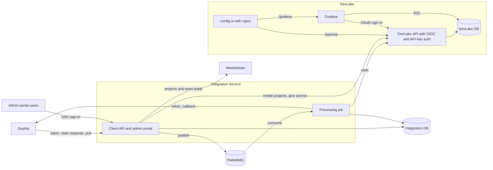
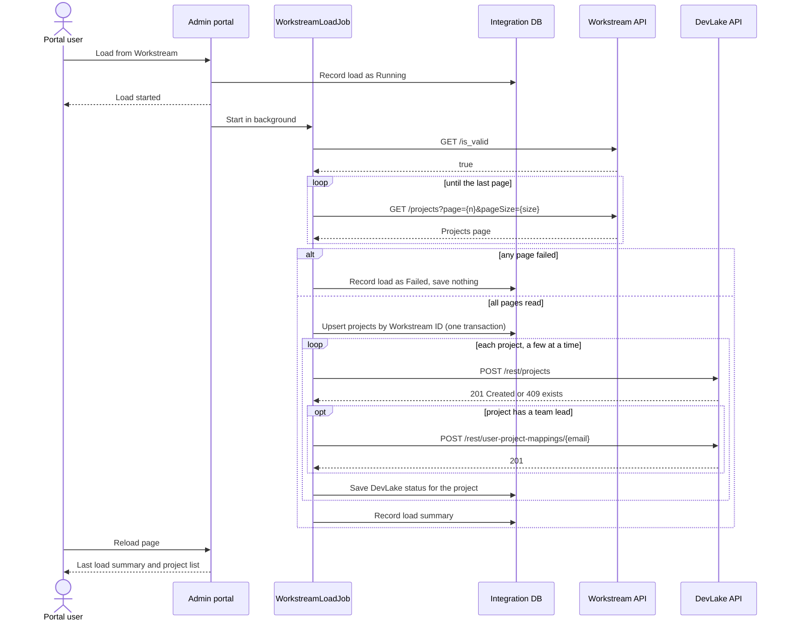
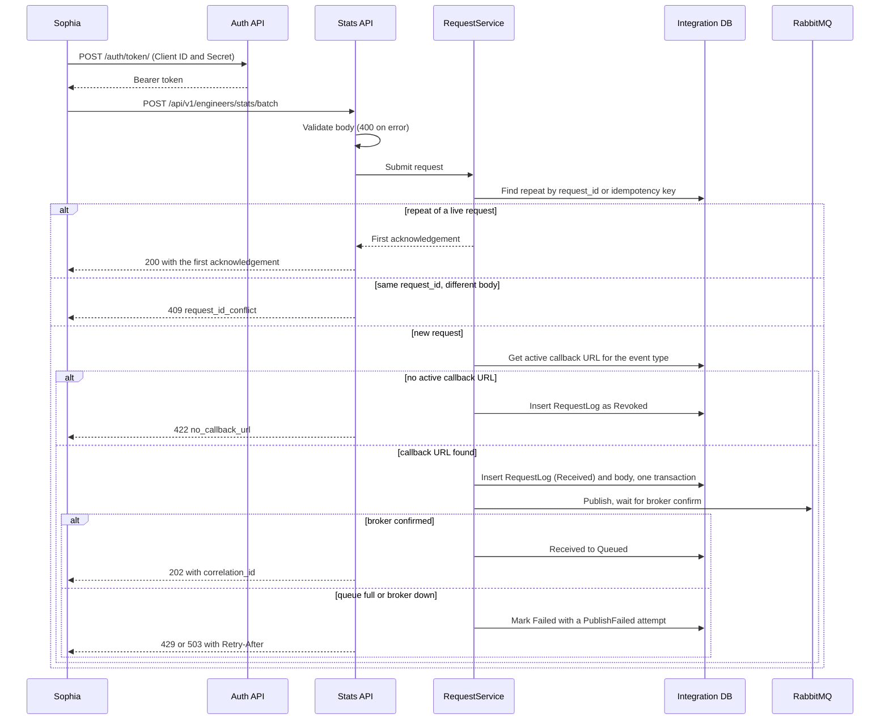
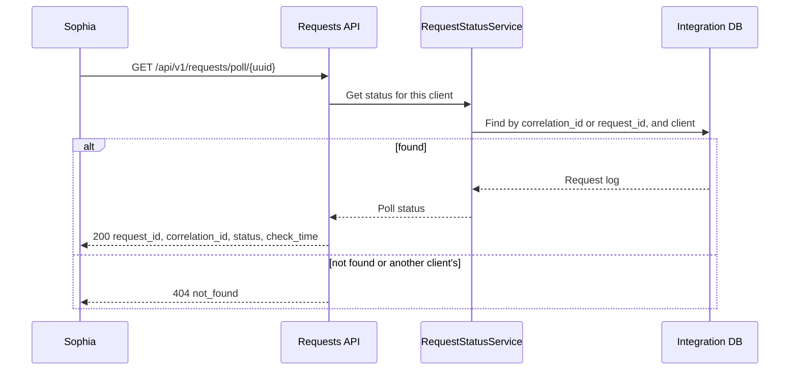
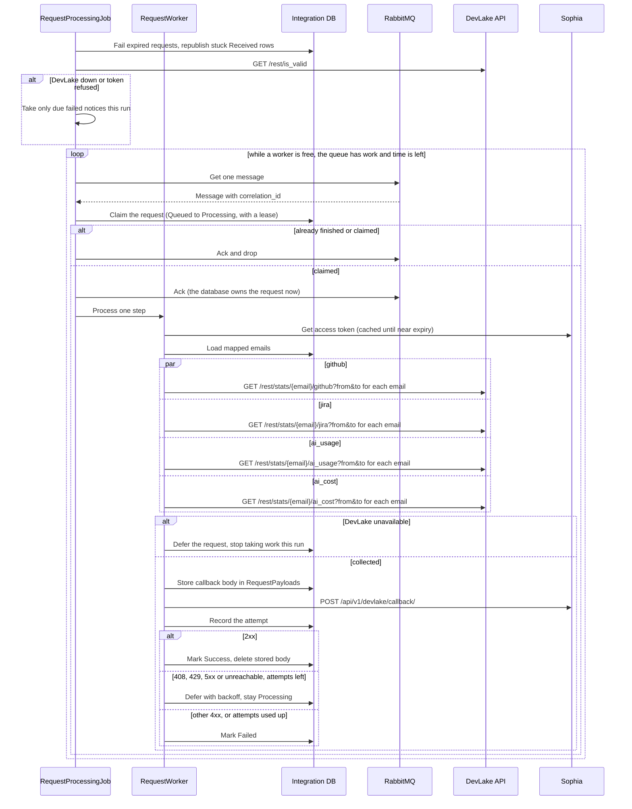
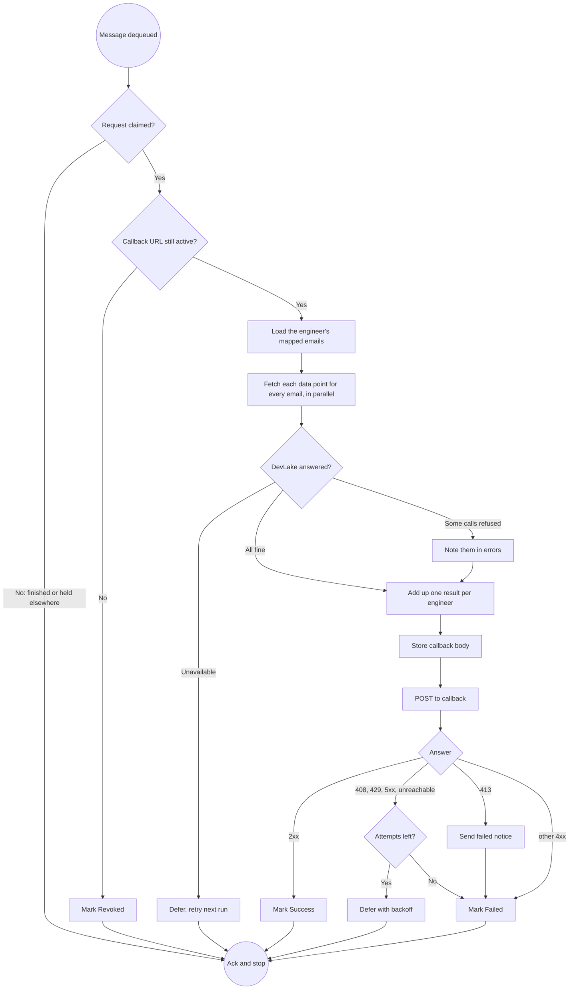

<!--
Licensed to the Apache Software Foundation (ASF) under one or more
contributor license agreements.  See the NOTICE file distributed with
this work for additional information regarding copyright ownership.
The ASF licenses this file to You under the Apache License, Version 2.0
(the "License"); you may not use this file except in compliance with
the License.  You may obtain a copy of the License at

    http://www.apache.org/licenses/LICENSE-2.0

Unless required by applicable law or agreed to in writing, software
distributed under the License is distributed on an "AS IS" BASIS,
WITHOUT WARRANTIES OR CONDITIONS OF ANY KIND, either express or implied.
See the License for the specific language governing permissions and
limitations under the License.
-->

# Integration Service

The Integration Service connects DevLake with third-party systems. Third-party systems that need DevLake data go through the Integration Service and never call DevLake directly. (DevLake's own config UI and Grafana still talk to DevLake and its database as before.)

It handles two integrations for now:

- **Sophia** asks for engineers' stats by their Arbisoft email. The service looks up the other emails each engineer commits with, collects their GitHub, Jira, AI usage and AI cost stats from DevLake, adds them up into one result per person, and posts the result to Sophia's callback API.
- **Workstream** is the source of projects and team leads. The service loads them, keeps them, creates or links the matching DevLake projects, and gives each team lead access to their project in DevLake.

Clients authenticate with a Client ID and Secret to get a bearer token. Stats requests are queued in RabbitMQ and processed in the background, so a slow DevLake response never times out the client's call.

The service now lives in its own repository, `arbisoft/devlake-integration-service`. Its README is the detailed, as-built reference (every setting, error code and status). This document is the design: what the service does, the contracts, and the work it needs on the DevLake side.

## Technology Stack
- Backend: .NET 10, chosen for the team's experience with its async and multi-threading model
- Database: MySQL
- Data access: Dapper with hand-written SQL
- Database migrations: DbUp
- Queue: RabbitMQ (one durable quorum queue, plus a dead-letter queue)

## Communication
Communication is asynchronous. A stats request is logged, queued in RabbitMQ and answered at once with a `correlation_id`. A background job processes it and posts the result to the client's callback API. This is needed because collecting one engineer's stats can take longer than a client's HTTP timeout, and because a burst of requests should wait in the queue instead of loading DevLake all at once.

The poll API is synchronous and returns the current status of a request.

## Authentication
- Protocol: OAuth 2.0 client credentials grant (RFC 6749 §4.4). It is machine-to-machine, with no end user, so there is no OpenID Connect and no `id_token`.
- Tokens: JWT access tokens signed with RS256, using keys from `SigningKeys`. The `kid` in the token header picks the key, so tokens signed before a key rotation still verify.
- Access is controlled by scopes. A token carries every scope its client has been given.

A client is first registered on the Integration Service. A Client ID and Secret are created for it and shared through Passbolt. The client sends these two values to our system's Auth API and receives a bearer token for the other APIs.

OpenID Connect is used in one place only: for people signing in to the admin portal (see [Security](#security)).

## API Contracts
These are the APIs agreed with Sophia. Every API except the Auth API needs the header `Authorization: Bearer <token>`.

| API | Method and path | Scope | Mode | Rate limit |
|---|---|---|---|---|
| Authentication | `POST [BASE_URL]/auth/token/` | none | Synchronous | 10 per minute per caller IP |
| Get Stats by Email List | `POST [BASE_URL]/api/v1/engineers/stats/batch` | `stats:read` | Asynchronous | 20 per minute per client, up to 20 emails each |
| Get Stats by Email | `GET [BASE_URL]/api/v1/engineers/{email}/stats?tf=24h` | `stats:read` | Asynchronous | 100 per minute per client |
| Fetch Request Status | `GET [BASE_URL]/api/v1/requests/poll/{uuid}` | `stats:read` | Synchronous | 100 per minute per client |

Rate limits use a sliding one-minute window. They are keyed by the Client ID from the token, except the Auth API, which is keyed by the caller's IP address (it has no token yet). A batch counts as one request, whatever the number of emails. A client over a limit gets 429 with a `Retry-After` header.

Field names are snake_case everywhere (`correlation_id`, `request_id`, `time_frame`, `data_points`). The paths `/auth/token/` and `/requests/poll/{uuid}` are kept as agreed with Sophia.

### Errors
Every 4xx answer from `/api` has one shape:

```json
{ "error": "invalid_payload", "detail": "emails: at most 20 items" }
```

`detail` names the field. The codes are:

| Status | `error` | When |
|---|---|---|
| 400 | `invalid_payload` | A missing or malformed field: a bad email on the single route, a bad period, an empty or too long `emails`, an unknown data point, a malformed poll ID |
| 400 | `no_acceptable_emails` | Every email in a batch was rejected. The body also has `rejected_emails` |
| 401 | `unauthorized` | No token, an expired, revoked or badly signed token. The answer also has `WWW-Authenticate: Bearer` |
| 403 | `forbidden` | The token lacks the route's scope |
| 404 | `not_found` | Unknown poll ID, **including one that belongs to another client** |
| 405 | `method_not_allowed` | A wrong HTTP method |
| 409 | `request_id_conflict` | A batch `request_id` already used with a different body |
| 415 | `unsupported_media_type` | A batch body that is not JSON |
| 422 | `no_callback_url` | The client has no active callback URL for this kind of request (see below) |
| 429 | `rate_limited` or `queue_full` | Over a rate limit, or the queue is full. With `Retry-After` |
| 503 | | The queue broker is unreachable. With `Retry-After` |

The Auth API keeps the OAuth 2.0 error body (RFC 6749 §5.2), because OAuth client libraries read it: `{ "error": "invalid_client", "error_description": "..." }` with 401.

### Authentication
Request headers:
- `Content-Type: application/x-www-form-urlencoded`
- `Authorization: Basic base64(client_id:client_secret)`

Request body:
```
grant_type=client_credentials
```

Response body (with `Cache-Control: no-store`):
```json
{ "access_token": "eyJhbGciOi...", "token_type": "Bearer", "expires_in": 3600, "scope": "stats:read" }
```

- A `scope` parameter is not needed. The token gets every scope assigned to the client in the admin portal, and `scope` in the answer lists them.
- `expires_in` is the client's token lifetime, set per client (60 to 86,400 seconds).
- Errors: `invalid_request` (400) for a malformed call, `unsupported_grant_type` (400), `invalid_client` (401) for a wrong ID or secret, an inactive client, or an expired or revoked secret.
- Secrets are checked with a slow hash, and the endpoint allows 10 calls a minute per IP, so guessing secrets is slow.

### Get Stats by Email List (batch)
This is Sophia's main route.

```json
{
  "request_id": "3f8c2a1e-6b7d-4e9a-9c1f-2d4b5a6e7f80",
  "emails": ["alice@arbisoft.com", "bob@gmail.com"],
  "data_points": ["pull_requests", "code_reviews", "ticket_complexity", "ai_usage", "ai_cost"],
  "time_frame": "1w"
}
```

- `request_id` (required): the client's own UUID. It is echoed in the acknowledgement, the callback and the poll answer, and it is the idempotency key (see [Repeats](#repeats-and-idempotency)).
- `emails` (required): 1 to 20. Each email is checked on its own. A valid email in an allowed domain is accepted. A valid email in another domain is rejected as `domain_not_allowed`. An empty or malformed one is rejected as `invalid_email`. Repeats are merged. Engineers DevLake does not know are accepted and come back with zeros. Only when every email is rejected is the request refused (400 `no_acceptable_emails`).
- `data_points` (required, at least one): any of `pull_requests`, `code_reviews`, `ticket_complexity`, `ai_usage`, `ai_cost`.
- Period: exactly one of `time_frame`, `from` and `to`, or `since` (see [Periods](#periods)).

Acknowledgement, **202 Accepted**:

```json
{
  "request_id": "3f8c2a1e-...",
  "correlation_id": "0b8f3c52-...",
  "status": "accepted",
  "accepted_emails": ["alice@arbisoft.com"],
  "rejected_emails": [{ "email": "bob@gmail.com", "reason": "domain_not_allowed" }],
  "estimated_completion_at": "2026-11-18T09:00:00Z"
}
```

### Get Stats by Email (single)
`GET /api/v1/engineers/{email}/stats?tf=1w` (or `from` and `to`, or `since`). It always collects all five data points. An invalid email gets 400; there is no partial acceptance on this route.

Acknowledgement, **202 Accepted**:

```json
{ "correlation_id": "0b8f3c52-...", "status": "accepted", "email": "abc@arbisoft.com", "estimated_completion_at": "2026-11-18T09:00:00Z" }
```

This route was agreed with Sophia as a GET, so it stays. To limit where the email ends up:

- The service never writes raw emails to its logs. `RequestLogs.url` stores the route template (`/api/v1/engineers/{email}/stats?tf={timeFrame}`), not the real URL.
- The request body, which holds the emails, is stored only in `RequestLogJsons` and shown only on the admin portal's request page.
- A repeat of the GET inside the duplicate window is answered with the first acknowledgement and queues nothing (see below), so a retrying proxy cannot create a second request.

### Periods
- **Time frame** (`time_frame`, or `tf` on the GET route): a whole number from 1 to 999 and a case-sensitive unit: `h` (hours), `d` (days), `w` (weeks), `M` (months) or `y` (years). For example `24h`, `1w`, `30d`, `11M`, `1y`. The longest allowed is one year. Anything else is 400 `invalid_payload`.
- **Range:** `from` and `to`, ISO 8601 with a time and an explicit offset (`Z` or `+05:00`). `from` must be earlier than `to`, and the range can be at most one year.
- **`since`:** a date `YYYY-MM-DD`, or the word `joining`. The window ends when the request was received. A date starts at 00:00 UTC that day; a date more than a year back is cut to one year, and a future date is refused. `joining` means the last year.

**The window is fixed when the request is received.** The service works out absolute UTC `from` and `to` from `requested_on` and sends DevLake only `from` and `to`. So a request that waited in the queue, or was retried, still covers the window the client meant, and every DevLake call for one request covers the same window. Months and years are calendar steps in UTC, the same way DevLake's own `tf` works.

### No callback URL
Before queueing, the service looks up the client's active callback URL for the request's event type: `engineer-stats` for the single route, `engineer-stats-batch` for the batch route. If there is none, the request is logged as `Revoked`, nothing is queued, and the API answers **422**:

```json
{ "request_id": "3f8c2a1e-...", "correlation_id": "0b8f3c52-...", "status": "rejected", "error": "no_callback_url" }
```

`request_id` appears for a batch only. The poll API shows the request as `Revoked`. A revoked request does not count as a duplicate, so the client can send the same request again once the callback exists. (422 was agreed with Sophia. Both callback URLs now exist, so this happens only when a URL is turned off in the portal.)

### Repeats and idempotency
- **Batch:** a repeat is found by `request_id`, never by content. The service stores a fingerprint of the body (a SHA-256 of the sorted emails, the period as sent and the sorted data points). A unique key on (client, `request_id`) stops two identical requests sent at the same moment from both being queued.

| The client's newest request with this `request_id` | Answer |
|---|---|
| none | queued, 202 |
| same body, not failed | 200 with the first acknowledgement, nothing queued |
| same body, failed or revoked | queued again, 202, new `correlation_id`, same `request_id` |
| different body | 409 `request_id_conflict` |

- **Single:** a repeat is found by content. An identical request (same client, email and period) inside `Requests:DuplicateWindowMinutes` (15) gets 200 and the first acknowledgement. A unique `idempotencyKey` column enforces it.
- **Callback side:** RabbitMQ delivers at least once, so the job may see a message twice. A worker takes a request only through an `UPDATE` that one worker can win, a finished request's message is acknowledged and dropped, and the delivery is recorded before the request is marked done. Sophia should still treat `correlation_id` as an idempotency key for callbacks.

### Fetch Request Status
`GET /api/v1/requests/poll/{uuid}` takes the `correlation_id` from an acknowledgement, or a batch's `request_id` (then it answers for the newest request with that `request_id`).

```json
{ "request_id": "3f8c2a1e-...", "correlation_id": "0b8f3c52-...", "status": "Processing", "check_time": "2026-11-05T14:02:55Z" }
```

`check_time` is the time of the call, as agreed with Sophia. A client can read only its own requests: an unknown ID and another client's ID both get the same 404.

### Request statuses
`status` in a request log is one of these values. The `statusReason` of a failure is recorded in `RequestResponseAttempts` (`attemptStatus` and `failureError`), not in the status itself.

| `RequestLogs` status | Set by | Next | Poll status | Final? |
|---|---|---|---|---|
| Received | API, in the same transaction as the body | Queued, Failed | `Queued` | no |
| Queued | API, after the broker confirms the publish | Processing, Failing | `Queued` | no |
| Processing | Job, when a worker claims it; also while a delivery waits for a retry | Success, Failing, Failed | `Processing` | no |
| Processed | reserved, not used now | | `Processing` | |
| Success | Job, when the callback accepted the result | | `Success` | yes |
| Failing | Job: the request failed and a failed notice is being delivered | Failed | `Failure` | no |
| Failed | Job or API | Queued (only by an admin's **Retry**) | `Failure` | yes |
| Revoked - no callback URL | API at intake, or the job if the URL was removed while it waited | | `Revoked` | yes |

`attemptStatus` is one of `Delivered`, `DeliveryFailed`, `FetchFailed`, `Expired`, `PublishFailed` or `Retried` (an admin retry).

### Callback (result delivery)
The service posts to the client's callback URL with an OAuth 2.0 client-credentials token from the client's own token API (for Sophia, `POST [SOPHIA_BASE_URL]/oauth2/token/`). One body shape is used for both routes.

A completed request:

```json
{
  "request_id": "3f8c2a1e-...",
  "correlation_id": "0b8f3c52-...",
  "status": "completed",
  "time_frame": "1w",
  "from": "2026-11-11T07:00:00Z",
  "to": "2026-11-18T07:00:00Z",
  "results": [
    {
      "email": "alice@arbisoft.com",
      "pull_requests": { "pull_requests_opened": 4, "pull_requests_merged": 3, "avg_pr_merge_hours": 12.5, "commits": 40, "additions": 1200, "deletions": 300, "by_repo": [], "by_team": [] },
      "code_reviews": { "reviews": 9, "review_comments": 14, "pull_requests_reviewed": 6 },
      "ticket_complexity": { "issues_resolved": 7, "story_points_resolved": 13, "issues_created": 5, "avg_resolution_hours": 30.2, "by_type": [], "by_team": [] },
      "ai_usage": { "providers": [], "monthly": [], "active_in_last_month": true },
      "ai_cost": { "models": [], "total_estimated_cost_usd": "12.40", "monthly": [] },
      "errors": []
    }
  ]
}
```

- `request_id` appears for a batch only. `time_frame`, or `since`, echoes what was sent. `from` and `to` are always there: the window the stats cover.
- `results` has one entry per accepted email, holding only the data points asked for. A data point with no data is there with zeros and empty lists. Mapped emails are never named.
- **Partial failure:** when DevLake refuses one email for one source, the rest is still delivered, and that person's `errors` lists the incomplete data point: `{ "data_point": "pull_requests", "error": "Some data could not be collected." }`.
- **Delivered** means any 2xx answer.

A failed request gets a failed notice:

```json
{ "request_id": "3f8c2a1e-...", "correlation_id": "0b8f3c52-...", "status": "failed", "error": "The request was not finished within 2 hours. Please send it again." }
```

A notice is sent when the request expired, its queue message could not be read, collecting failed in a way waiting cannot fix, or the callback answered 413 to the result.

**Retries:** an unreachable callback, 408, 429 or 5xx is tried again after 30 seconds, doubling each time (or the callback's `Retry-After` if longer), never more than 15 minutes apart, up to the client's `maxAttempts`. Then the request ends `Failed`. Any other 4xx means the callback refuses this result, and the request ends `Failed` at once. A request may live two hours from when it was queued; after that it fails with the "not finished within 2 hours" notice. Polling shows `Failure` in every case.

### What we need from Sophia
- Client ID and Secret for calling Sophia's `/oauth2/token/`, for Stage and for Prod. (These are Sophia's credentials for our calls to Sophia. The credentials Sophia uses to call us are issued from our admin portal.)
- That Sophia treats `correlation_id` as an idempotency key on its callback.

Both callback APIs (single and batch) are now available.

## DevLake-side changes
The Integration Service needs these on DevLake. They are built and merged in this fork (`main-arbisoft`).

| Change | Where | Notes |
|---|---|---|
| `GET /rest/is_valid` | `backend/server/api/integration` | Answers `true` for a valid API key. Used by the admin portal's **Check token** and by the job before a run |
| `GET /rest/stats/{email}/jira`, `/github`, `/ai_usage`, `/ai_cost` | `backend/server/api/integration` | Take `tf`, or `from` and `to`. Response fields are listed in the service README |
| API key for the service | DevLake config UI, API keys page | Allowed path `^/(is_valid|stats/.+|projects|user-project-mappings/[^/]+)$` |
| `POST /rest/projects`, `POST /rest/user-project-mappings/{email}` | existing DevLake APIs | Used by the Workstream load to create projects and give team leads access |

These routes sit under `/rest`, so DevLake's API-key check applies to them. A direct call without `/rest` gets 401. DevLake has no project ingestion screen or `/projects/load` API: the Workstream load runs in the Integration Service (see below).

Metric definitions:

- **GitHub:** commits, additions and deletions match on the commit author email. Pull request authorship and reviews match on the account's email.
- **Jira:** issues match on the Jira account's email.
- **AI usage and cost:** match on the user email in the AI tables. The data is daily, so these windows cover whole UTC days.

## Architecture Diagram



Access control is inside the DevLake backend (OIDC sessions for people, API keys for services). Grafana signs people in with OAuth through DevLake.

## Domain Diagram
All `*On` columns are UTC, stored as `DATETIME(6)`. Columns marked `"nullable"` may be null.

```mermaid
erDiagram

    EmailMappings {
        bigint id PK
        string arbisoftEmail "normalized"
        string email "normalized"
        string emailAsReceived
        DateTime createdOn
    }

    Clients {
        bigint id PK
        string clientId UK
        string name
        bool isActive
        int accessTokenLifetimeSeconds
        DateTime createdOn
        string createdBy
        DateTime modifiedOn "nullable"
        string modifiedBy "nullable"
    }

    ClientSecrets {
        bigint id PK
        bigint clientRefId FK
        string secret "PBKDF2 hash only"
        DateTime expiresOn "nullable"
        DateTime revokedOn "nullable"
        DateTime lastUsedOn "nullable"
        DateTime createdOn
        string createdBy
    }

    ClientScopes {
        bigint id PK
        bigint clientRefId FK
        bigint scopeId FK
        DateTime createdOn
        string createdBy
    }

    Scopes {
        bigint id PK
        string name UK
        string description
        DateTime createdOn
    }

    SigningKeys {
        bigint id PK
        string kid UK
        string algorithm
        string publicKey
        string privateKeyRef
        DateTime activatedOn
        DateTime retiredOn "nullable"
        DateTime createdOn
    }

    SecretStoreEntries {
        bigint id PK
        string secretRef UK
        string encryptedValue "AES-256-GCM"
        DateTime createdOn
        DateTime modifiedOn "nullable"
        string modifiedBy "nullable"
    }

    AccessTokens {
        bigint id PK
        string jti UK
        bigint clientRefId FK
        bigint clientSecretId FK
        bigint signingKeyId FK
        string grantedScopes
        DateTime issuedOn
        DateTime expiresOn
        DateTime revokedOn "nullable"
        string revokedReason "nullable"
        string issuedToIp
    }

    Clients ||--o{ ClientSecrets : clientRefId
    Clients ||--o{ ClientScopes : clientRefId
    Scopes ||--o{ ClientScopes : scopeId
    Clients ||--o{ AccessTokens : clientRefId
    ClientSecrets ||--o{ AccessTokens : clientSecretId
    SigningKeys ||--o{ AccessTokens : signingKeyId
    SigningKeys ||--|| SecretStoreEntries : privateKeyRef

    RequestLogs {
        bigint id PK
        bigint clientRefId FK
        string correlationId UK
        string requestId "nullable, batch only"
        string requestFingerprint "nullable"
        string requestIdKey UK "nullable"
        string idempotencyKey UK "nullable"
        string url "route template"
        string status
        string eventType
        DateTime nextAttemptOn "nullable"
        DateTime claimedUntil "nullable"
        DateTime createdOn
        DateTime modifiedOn "nullable"
        DateTime queuedOn
    }

    RequestLogJsons {
        bigint id PK
        bigint requestLogId FK
        json json
    }

    RequestPayloads {
        bigint requestLogId PK
        string payload
        DateTime createdOn
    }

    RequestResponseAttempts {
        bigint id PK
        bigint requestLogId FK
        string requestJson "nullable"
        string responseJson
        string attemptStatus
        string failureError "nullable"
        string attemptBy
        DateTime attemptOn
    }

    ClientConfigs {
        bigint id PK
        bigint clientRefId UK
        string authType
        string baseUrl
        string tokenUrl "nullable"
        string outboundClientId "nullable"
        string outboundClientSecretEncrypted "nullable"
        string outboundScope "nullable"
        string apiTokenEncrypted "nullable"
        DateTime tokenExpiresOn "nullable"
        DateTime tokenRotatedOn "nullable"
        int maxAttempts
        bool isActive
        DateTime createdOn
        string createdBy
        DateTime modifiedOn "nullable"
        string modifiedBy "nullable"
    }

    ClientConfigOutboundUrls {
        bigint id PK
        bigint clientConfigId FK
        string eventType
        string path
        string method
        bool isActive
        DateTime createdOn
        string createdBy
        DateTime modifiedOn "nullable"
        string modifiedBy "nullable"
    }

    Clients ||--o| ClientConfigs : clientRefId
    ClientConfigs ||--o{ ClientConfigOutboundUrls : clientConfigId
    Clients ||--o{ RequestLogs : clientRefId
    RequestLogs ||--|| RequestLogJsons : requestLogId
    RequestLogs ||--o| RequestPayloads : requestLogId
    RequestLogs ||--o{ RequestResponseAttempts : requestLogId

    WorkstreamProjects {
        string workstreamId PK
        string name
        string teamLeadName "nullable"
        string teamLeadEmail "nullable"
        string devLakeProjectName "nullable"
        string devLakeStatus "nullable"
        string devLakeError "nullable"
        string accessGrantedTo "nullable"
        DateTime lastLoadedOn
        DateTime createdOn
        string createdBy
    }

    WorkstreamProjectLoads {
        bigint id PK
        DateTime startedOn
        DateTime finishedOn "nullable"
        string startedBy
        string outcome
        int projects
        int created
        int linked
        int accessGiven
        int failed
    }

    PortalUsers {
        bigint id PK
        string username UK "nullable, local admin"
        string passwordHash "nullable"
        string email UK "nullable, SSO users"
        string role
        bool isActive
        DateTime lastSignInOn "nullable"
    }

    AuditLogs {
        bigint id PK
        DateTime occurredOn
        string actorKind
        string actorName
        string action
        string entityType
        string entityId
        json changes "nullable"
        string reason "nullable"
    }
```



- **EmailMappings:** the other emails each engineer commits with, keyed by their Arbisoft email. The Arbisoft email itself is always included in a lookup and is not stored as a row. Both columns are trimmed, lower-cased and compared with a binary collation. Unique key on (`arbisoftEmail`, `email`).
- **Clients:** third-party systems registered with the service, with a public Client ID, an active flag and the lifetime of their tokens.
- **ClientSecrets:** the secrets a client sends with its Client ID. Only a PBKDF2-SHA256 hash is stored; the plain secret is shown once, when it is created. A client can have several, so a secret can be rotated without downtime. A new secret has no `revokedOn` or `lastUsedOn`.
- **ClientScopes:** links each client to its scopes. Unique key on (`clientRefId`, `scopeId`).
- **Scopes:** the permissions a token can carry. Today there is one: `stats:read`.
- **SigningKeys:** the keys that sign access tokens. The public key is in the table; the private key is in `SecretStoreEntries`, named by `privateKeyRef`.
- **SecretStoreEntries:** secrets the service itself needs, encrypted with AES-256-GCM: private signing keys and the DevLake and Workstream API tokens.
- **AccessTokens:** every token the Auth API issues. Setting `revokedOn` invalidates a token before it expires.
- **RequestLogs:** every stats request and its status. `requestIdKey` and `idempotencyKey` are the unique keys for repeats. `nextAttemptOn` and `claimedUntil` let the job defer a request and hold it with a lease. Indexes on (`status`, `createdOn`), (`status`, `queuedOn`), `nextAttemptOn` and (`clientRefId`, `requestId`, `createdOn`).
- **RequestLogJsons:** the request body, one per request log, in a MySQL `JSON` column.
- **RequestPayloads:** the callback body, stored once collected so every delivery attempt sends the same thing. It is deleted when the request finishes.
- **RequestResponseAttempts:** each delivery attempt, with the body sent, the answer received and the error.
- **ClientConfigs:** how the service authenticates when it calls a client back. `authType` is `OAuth2ClientCredentials` (token URL, outbound Client ID, encrypted secret, scope) or `ApiToken` (an encrypted static token, with `tokenExpiresOn` and `tokenRotatedOn` for that token). The OAuth access token itself is cached in memory, not stored. `maxAttempts` caps delivery attempts (1 to 10).
- **ClientConfigOutboundUrls:** the callback endpoints per event type: an HTTP method and a path relative to the base URL. Only one row can be active per event type; the admin portal enforces this.
- **WorkstreamProjects** and **WorkstreamProjectLoads:** the projects loaded from Workstream, their link to DevLake, and a record of each load.
- **PortalUsers:** the people who can sign in to the admin portal and their role.
- **AuditLogs:** who changed what, and when.

**Outbound credentials.** The client callback credentials live in `ClientConfigs`. The DevLake and Workstream API tokens are not clients, so they live in `SecretStoreEntries` and are entered on the admin portal's **Upstream tokens** page. They can be replaced there at any time and take effect within a minute. DevLake stores nothing for the service, because DevLake no longer calls it.

## Sequence Diagrams

### 1. Loading projects from Workstream
An admin portal user starts the load. It runs in the background, so a long load never holds a browser request open.



- Projects are matched by Workstream ID. A project that left Workstream keeps its row, and its older `lastLoadedOn` shows that.
- A refusal for one project marks only that project `Failed`. DevLake being down or refusing the token stops the sync; the projects it did not reach are marked `NotSynced`.
- Access is only ever added. The service never sends a `DELETE` to DevLake.

### 2. Sophia asking for data

#### Receiving a request
The request is recorded before it is published (an outbox), so a message always has a row.



If the process stops between the commit and the publish, the row stays `Received`. The processing job publishes such rows again after a minute.

#### Fetching request status



#### Processing requests
A hosted background job runs every 30 seconds. It is the only consumer. It reads the queue one message at a time with manual acknowledgement, and works on at most 4 requests at once.



- Only the data points a request asks for are fetched. Each DevLake call goes through a process-wide limit of 8 calls in flight, a timeout, retries for temporary errors only, and a circuit breaker.
- One email refused by DevLake for one source goes into that person's `errors`; the rest is delivered.
- A message that cannot be read, or that was redelivered more than 5 times, goes to the dead-letter queue and its request fails with a notice.
- A request is acknowledged on the queue only once its row is claimed in the database. After that, waits (backoff, DevLake down) are kept in `nextAttemptOn`, not in the queue.
- Before working on a request, the worker checks its callback URL again. If it was removed while the request waited, the request becomes `Revoked`.

**Load on DevLake.** A single request makes at most 4 × N calls, where N is the number of the engineer's emails, and only for the data points asked for. With 4 requests at a time and at most 8 DevLake calls in flight, DevLake never sees more than 8 concurrent calls from the service, however many requests are queued. Requests wait in the queue instead.

### 3. Processing flowchart



Email format and domain are checked at intake, so they never reach processing.

## Security
- **Client secrets** are stored only as PBKDF2-SHA256 hashes. A secret is shown once.
- **Encryption key:** `Security:EncryptionKey` (32 bytes, base64) encrypts the outbound client secrets, the upstream API tokens and the private signing keys. It is set by the deployment, never stored in the database or the image. If it is lost, rotate to a new signing key and enter the outbound secrets and upstream tokens again.
- **Signing keys:** private keys are stored encrypted in `SecretStoreEntries`. An environment variable `Secrets__<privateKeyRef>` overrides the stored copy, so a deployment can keep a key in a vault. Rotation is done in the admin portal; retired keys stay so issued tokens keep verifying until they expire.
- **Token revocation:** every API call checks, in one indexed query, that the token, its client and its secret are not revoked. Token lifetimes are short (one hour by default).
- **Admin portal:** people sign in with their Arbisoft account through OpenID Connect (authorization code with PKCE), limited to `arbisoft.com` emails. A new account has no access until an admin gives it the Editor or Admin role. One local `admin` account exists for first setup and must change its password at first sign-in. Every page needs a role, POSTs need an anti-forgery token, and sign-in attempts are rate limited.
- **Audit log:** sign-ins, every change made in the portal, every request status change, and every token issued or refused are recorded in `AuditLogs` and kept.
- **Network:** the portal and the client API are one process. If the portal must not be public, restrict its page paths at the reverse proxy.
- **Retention:** request bodies (`RequestLogJsons`) and delivery attempts are kept, because they are needed for audits. The stored callback body (`RequestPayloads`) is deleted when the request finishes.

## Deployment
Run **one instance**. Several things are in the process, not in shared state: the rate limits, the DevLake concurrency limit, the Sophia token cache, the processing job and the one-at-a-time lock on Workstream loads. DbUp applies migrations at startup, which is safe with one instance. Running more than one instance would need a shared rate limiter, a separate worker for the job, and migrations as a one-off step.

## Project Structure
The solution uses an N-Layer architecture. Each layer references only the layer directly below it:

- Presentation (`API`): the one deployable host. Controllers, authorization, rate limiting, background jobs, and the Razor Pages admin portal.
- Business (`Business`): DTOs, services, validation, and token and encryption logic.
- Data Access (`DataAccess`): models, Dapper repositories, SQL migrations applied by DbUp, external API clients and RabbitMQ.

Services and repositories have an interface next to their implementation, so tests can replace them. Repositories own their child tables: `ClientRepository` owns secrets and scopes, `RequestLogRepository` owns request bodies, payloads and attempts, and `ClientConfigRepository` owns callback URLs.

DbUp runs the scripts in `Persistence/Migrations` in filename order and records each in its journal table, so a script runs only once. A failed script stops startup.

```
Arbisoft.DevLake.IntegrationService
├──Arbisoft.DevLake.IntegrationService.API
│  ├──Controllers          AuthController, StatsController, RequestsController
│  ├──Authorization        scopes, token revocation, signing key lookup
│  ├──RateLimiting
│  ├──BackgroundJobs       RequestProcessingJob, WorkstreamLoadJob
│  ├──Middleware           client API error shape
│  ├──Pages                admin portal: Clients, Scopes, SigningKeys, AccessTokens,
│  │                       EmailMappings, ClientConfigs, RequestLogs, UpstreamTokens,
│  │                       WorkstreamProjects, Users, AuditLogs, Account
│  └──Portal               portal sign-in and roles
├──Arbisoft.DevLake.IntegrationService.Business
│  ├──Dtos                 Auth, Stats, Projects, Admin, Errors
│  ├──Services
│  │  ├──Auth              token issuing
│  │  ├──Requests          intake, idempotency, periods, poll
│  │  ├──Processing        claim, collect, aggregate, deliver, retry, sweep
│  │  ├──Projects          Workstream load and DevLake sync
│  │  ├──Admin             portal services
│  │  └──Audit
│  ├──Security             secret hashing, encryption, secret store, JWT
│  └──Validation
├──Arbisoft.DevLake.IntegrationService.DataAccess
│  ├──Models
│  ├──Repositories
│  ├──Persistence/Migrations
│  ├──ExternalApis         DevLake, Sophia, Workstream
│  └──Messaging            RabbitMQ publisher, consumer, topology
└──Arbisoft.DevLake.IntegrationService.UnitTests
```

## Open items
- **EmailMappings and DevLake's identity model.** DevLake's stats match each email directly (commit author email, account email), not through `user_accounts`, so calling once per email does not count the same row twice. Two places can still count twice: a pull request touched by two of one person's emails, and an AI active day used by two of them. Moving the mapping into DevLake's `users`/`user_accounts` is a possible later change; for now the mapping stays in the service because many DevLake accounts hide their email.
- **One commit email mapped to two engineers** is not blocked yet. A unique key on `email` would block it.
- **Workstream's response shape** is not documented. The mapper accepts the common field names until the real shape is known.
