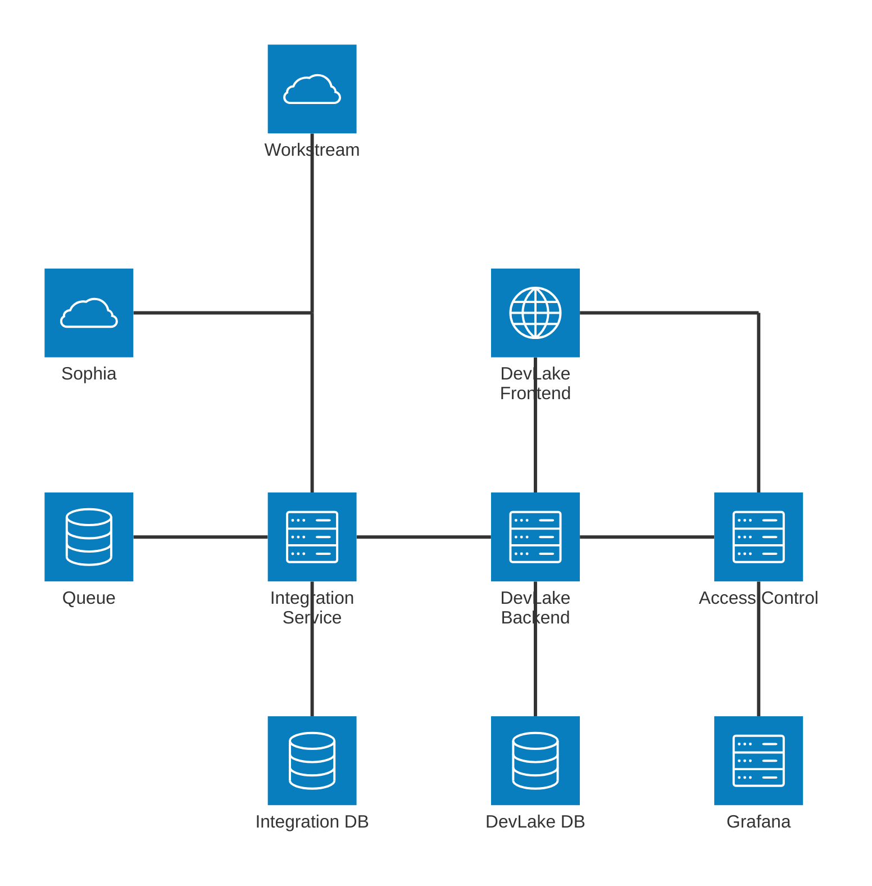
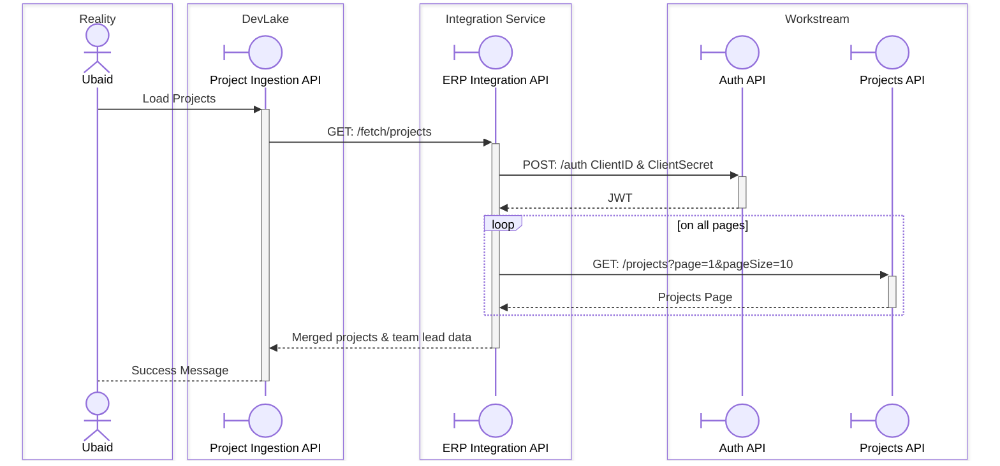
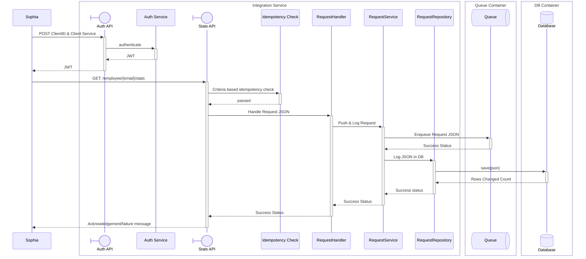
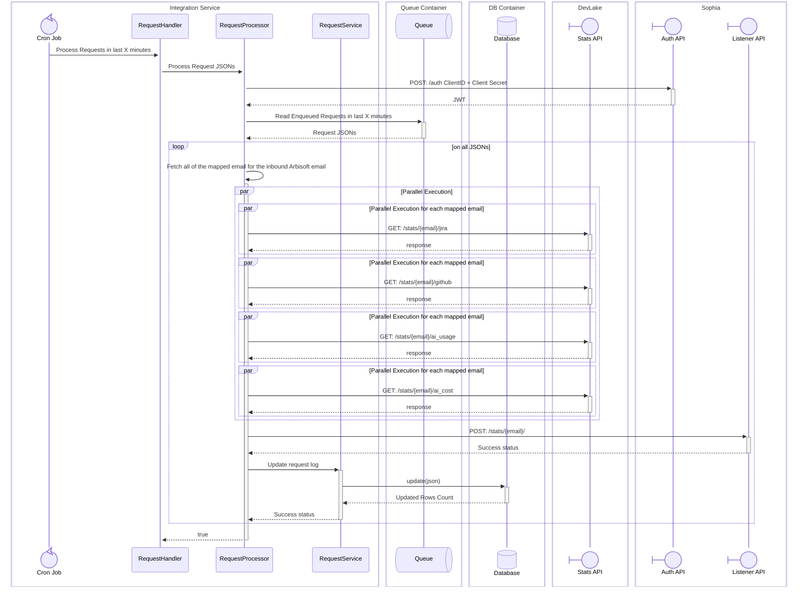
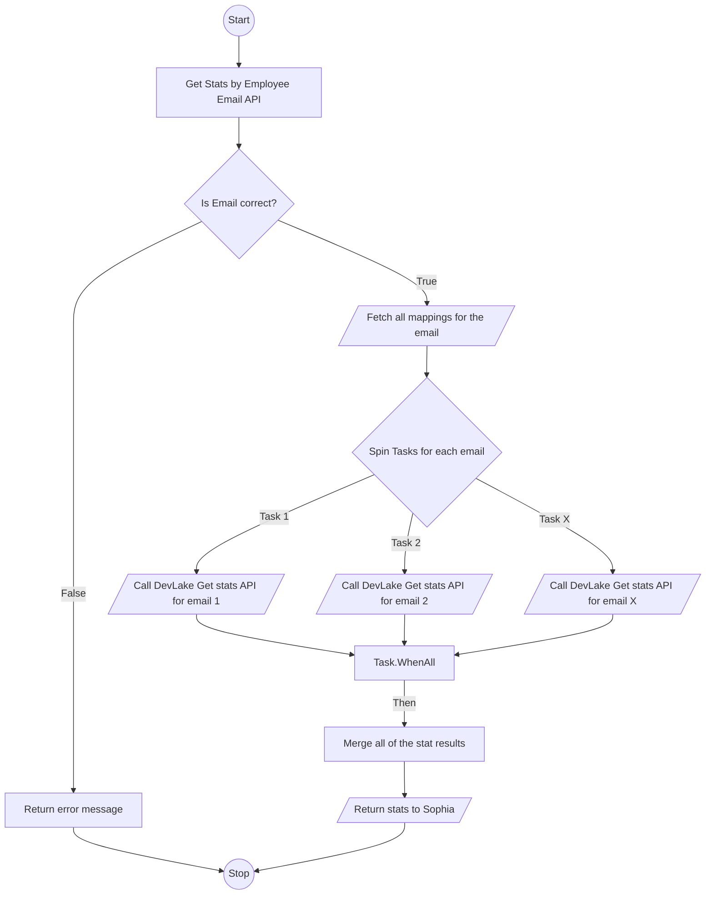

# Integration Service
This integration service is to connect DevLake with 3rd party systems. All of the systems who want to take data from DevLake must interact only with Integration Service, not directly with DevLake.

## Technology Stack
- Backend: .NET 10, I have selected this stack because I have better knowledge of managing multi-threaded operations.
- Database: PostgreSQL / MySQL, any of these DBs would be work.
- Queuing System: RabbitMQ / MassTransit, totally depends upon the availability of on-prem resources.

## Communication
I have selected Asynchronous mode of communication for this service, such that if there are too many requests coming in from the client system then the service would simply push the request to queuing system, and would process it on its own processing time.

Secondly, the data required from Sophia against single engineer can cause frequent API timeouts, hence async communication is the best option.

## Authentication
I have selected OAuth2 Authentication Mode, the client will be first registered on the integration service. A Client ID and Secret will be created for the client, client will pass these 2 values to our systems auth API, and will receive a JWT token to access the APIs.

## Architecture Diagram
As per my understanding, current DevLake system is the right hand side of the diagram. I have added the left side of the diagram for integration with Sophia and other systems.



## Domain Diagram

```mermaid
erDiagram

    EmailMappings {
        bigint id PK
        string arbisoftEmail
        string email
        DateTime createdOn
    }

    Clients {
        bigint id PK
        string name
        string clientId UK
        string clientSecret UK
        DateTime createdOn
    }

    ClientConfigs {
        bigint id PK
        bigint clientId FK
        string outboundClientId
        string outboundClientSecret
    }

    ClientConfigOutboundUrls {
        bigint id PK
        bigint clientConfigId FK
        string url
        string method
        string createdOn
        DateTime createdBy
        string modifiedOn
        DateTime? modifiedBy
    }

    RequestLogs {
        bigint id PK
        string clientId FK
        string correlationId
        string url
        string status
        string eventType
        DateTime createdOn
    }

    RequestLogJsons {
        bigint id PK
        bigint requestLogId FK
        string json
    }

    RequestResponseAttempts {
        bigint id PK
        bigint requestLogId FK
        string responseJson
        string attemptStatus
        string? failureError
        string attemptBy
        DateTime attemptOn
    }


    Clients ||--o{ RequestLogs : clientId
    Clients ||--o{ ClientConfigs : clientId
    ClientConfigs ||--o{ ClientConfigOutboundUrls : clientConfigId
    RequestLogs ||--o{ RequestLogJsons : requestLogId
    RequestLogs ||--o{ RequestResponseAttempts : requestLogId

```
- EmailMappings: This table has the mapping between Arbisoft email and other emails, using which the engineers are commiting on GitHub.
- Clients: This table has ClientID and ClientSecret for the 3rd party systems.
- ClientConfigs: This table has the configuration (ClientID & ClientSecret) using which Integration Service will authenticate itself to send data to this client.
- ClientConfigOutboundUrls: This table has the API URLs and the HTTP Methods on which integration service will send data.
- RequestLogs: This table keeps the record of the requests coming in the system, and also the status of the request's response. Status = Received/Queued/Processed/Success/Failed
- RequestLogJsons: This table has the JSON of the request log.
- RequestResponseAttempts: This table has the response and the status, as well as the attempts made to send the data on the configured Outbound URL.

## Sequence Diagram
### 1. Loading Projects on DevLake


### 2. Sophia asking for data

#### Pushing Requests in Queue


#### Processing Requests


### 3. Sophia DevLake Flowchart


